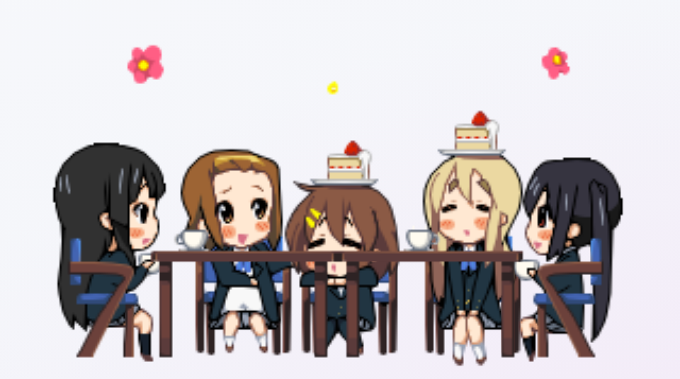
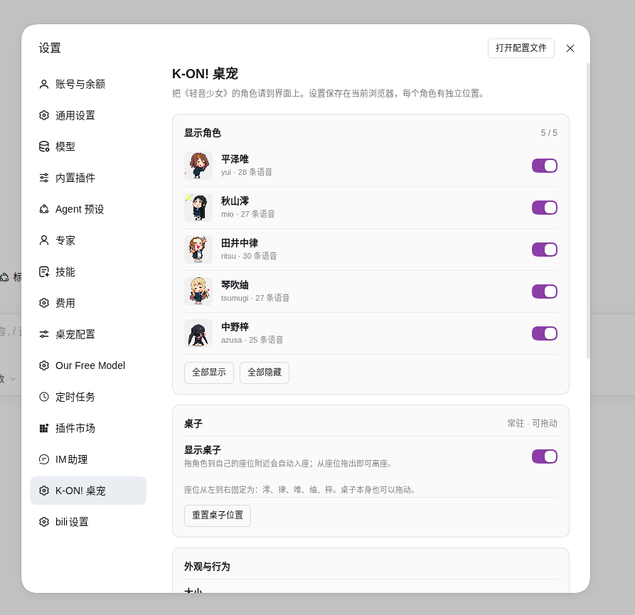
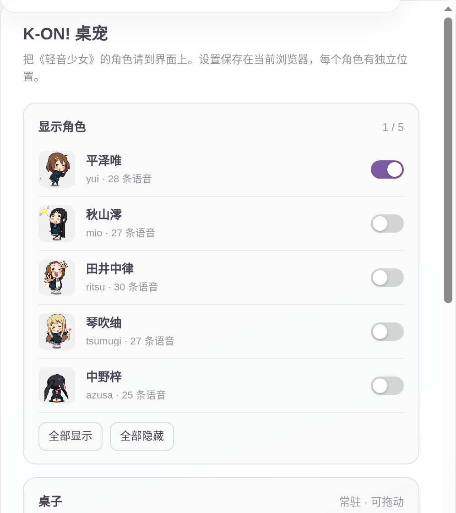

# dsh-k-on-pet

把《K-ON! 轻音少女》的五位角色挂进 **DeepSeek Harness** 的 Web 界面右下角。

这是一个 **DSH 客户端插件**：不改 DSH 源码，不另起窗口，安装后直接悬浮在 Web GUI 上。点击说话、拖动乱跑、双击比心；在 DSH 设置里开关角色、同时显示多人、调大小；还有一张可以拖动的茶桌，把角色拖到自己的座位就会入座。闲置会打瞌睡，忙久了会提醒你喝水休息。

> 非官方同人移植，与原作者、京都动画、芳文社均无关联。资产版权说明见 [THIRD_PARTY_NOTICES.md](THIRD_PARTY_NOTICES.md)。


<sub>真实 DSH 0.2.1-rc.2 右下角实拍：</sub>


<sub>茶桌与五人入座（`docs/table.png`）：</sub>



<sub>DSH「设置 → K-ON! 桌宠」分区：</sub>



## 角色与内容

| 角色 | id | 语音 |
| --- | --- | --- |
| 平泽唯 | `yui` | 28 条 |
| 秋山澪 | `mio` | 27 条 |
| 田井中律 | `ritsu` | 30 条 |
| 琴吹䌷 | `tsumugi` | 27 条 |
| 中野梓 | `azusa` | 25 条 |

共 **137 条原版语音**，每张 96×96 精灵图集，包含 6 组动作：

- `idle` 主待机、`idleAlt` 待机变体、`extra` 额外待机
- `react` 被点击、`sleep` 打瞌睡、`held` 被拎起来

## 功能

- **点击**：切换 `react` 动作并随机播一条语音，气泡显示台词。
- **双击**：比心 + 随机台词。
- **拖动 / 甩出**：抓起时播 `held`，松手按速度做抛物线，落地后恢复待机；拖出屏幕会被夹回可视区。
- **闲置**：约 4 分钟无操作进入 `sleep`，再久一点冒 `Zzz` 气泡；任意交互唤醒。
- **随机闲聊**：每 2.5–5 分钟说一句。
- **关怀提醒**：每 50 分钟提醒喝水 / 起身 / 看远处。
- **角色设置**：DSH **设置 → K-ON! 桌宠** 里独立开关五位角色，可同时显示；支持全部显示 / 全部隐藏。
- **茶桌**：默认常驻界面底部偏上（聊天输入框上方），可在设置里关闭，也可以按住桌面拖动；把角色拖到自己的固定座位附近会自动入座，从座位拖出即离座。
- **外观与行为**：统一大小（1.0–2.4×）、语音、随机闲聊、关怀提醒，以及一键恢复默认。
- **右键菜单**：隐藏这只、把这只重置回右下角。菜单是页面内浮层，不依赖浏览器弹窗。
- **记忆**：可见角色、大小、语音/闲聊/关怀开关、每个角色各自的坐标，存在浏览器 `localStorage`，刷新后恢复。
- **不挡操作**：只有宠物本体接收指针事件，其余区域点击穿透。
- **无网络、无模型调用**：不请求外部接口，不上传任何数据。

## 设置

打开 **DSH 设置 → K-ON! 桌宠**：

<sub>设置页（本地夹具渲染）：</sub>



| 项 | 说明 | 默认 |
| --- | --- | --- |
| 角色开关 | 五位角色各自独立，可同时显示 | 仅平泽唯 |
| 桌子 | 显示茶桌；可拖动，角色拖到座位自动入座 | 开 |
| 全部显示 / 全部隐藏 | 一次切换所有角色 | — |
| 大小 | 统一缩放，范围 1.0–2.4× | 1.5× |
| 语音 | 点击 / 双击时播放原版语音 | 开 |
| 随机闲聊 | 待机时每 2.5–5 分钟说一句 | 开 |
| 关怀提醒 | 每 50 分钟提醒喝水 / 休息 | 开 |
| 导出 / 导入 | 把偏好导出为 JSON，或从备份恢复 | — |
| 恢复默认 | 回到仅唯、1.5×、右下角 | — |

每个角色有独立坐标：第一次显示时按当前可见数量依次排开，之后拖动到哪里就记住哪里。设置页和宠物右键菜单读写同一份偏好。

## 安装

要求：DSH **Web** profile（桌面端或 `dsh web`），DSH `0.2.x`。当前在 `0.2.1-rc.2` 上实测通过。

### 方式一：插件面板（推荐）

在 DSH 的 **插件 / 插件市场** 里搜索 `dsh-k-on-pet`，安装并启用。面板会同时处理依赖和 bundle 注册。

### 方式二：命令行

```bash
dsh plugin --profile web add dsh-k-on-pet
```

CLI 只把包装进 profile 的 `node_modules`；还需要让 profile 加载它。打开
`$DSH_HOME/profiles/web/package.json`（默认 `~/.dsh/profiles/web/package.json`），把
`"dsh-k-on-pet"` 加进 `dsh.profile.bundles` 数组：

```json
{
  "dsh": {
    "profile": {
      "bundles": ["@deepseek-ai/dsh-base", "@deepseek-ai/dsh-web-app", "dsh-k-on-pet"]
    }
  }
}
```

然后重启 `dsh web` / 桌面端。

### 从 GitHub 安装

```bash
dsh plugin --profile web add github:sunjay-lee/dsh-k-on-pet
```

同样把 `dsh-k-on-pet` 加入 `dsh.profile.bundles` 后重启。仓库内已包含构建好的 `lib/` 与 `assets/`，安装时不需要编译。

### 卸载

从 `dsh.profile.bundles` 移除 `dsh-k-on-pet`，然后：

```bash
dsh plugin --profile web remove dsh-k-on-pet
```

### 验证是否加载

登录 DSH Web 后访问：

```bash
curl -s http://127.0.0.1:3080/dsh-k-on-pet/characters/yui/meta.json | head
```

能返回 JSON 说明宿主半已挂载；页面右下角出现唯，说明客户端半已渲染；打开 **设置 → K-ON! 桌宠** 能看到角色开关，说明设置分区已注册。

## 使用

| 操作 | 效果 |
| --- | --- |
| 左键单击 | 动作 + 语音 + 气泡 |
| 左键双击 | 比心台词 |
| 按住拖动 | 拎起；松手按速度甩出 |
| 右键 / 悬停右上角齿轮 | 宠物菜单 |
| 菜单「隐藏这只」 | 关闭该角色，可在 DSH 设置里重新打开 |
| 菜单「回到右下角」 | 清除该角色的位置记忆 |
| 拖到桌边座位 | 自动入座；从座位拖出恢复站立 |
| 拖动桌面 | 整张桌子换位置（设置页可恢复默认） |
| DSH 设置 → K-ON! 桌宠 | 角色显隐、桌子、大小、语音、闲聊、关怀、导入导出、恢复默认 |

所有设置只保存在当前浏览器。换浏览器或清空站点数据会恢复默认（仅唯、1.5×、右下角）；需要迁移时用设置页的导出 / 导入。DSH 设置页和宠物右键菜单读写的是同一份偏好。

## 备份与设置迁移

设置保存在当前浏览器的 `localStorage`：

- 当前版本：`dsh-k-on-pet:v2`
- 旧版单角色设置：`dsh-k-on-pet:v1`，首次读取时自动迁移到 v2

换浏览器、清空站点数据或换设备时，可以在设置页先**导出设置**，在新环境里**导入设置**。导入会覆盖当前偏好；JSON 里只有角色显隐、大小、声音/闲聊/关怀开关和坐标，不包含任何账号或会话数据。

## 隐私与权限

- 宿主半只注册一个**只读**静态路由：`/dsh-k-on-pet/characters/*` 与 `/dsh-k-on-pet/table/*`，用于把图集、`meta.json`、MP3 和茶桌素材发给同源页面。
- 不做遥测、不访问网络、不读写工作区文件、不调用模型。
- 客户端只用 `localStorage` 保存偏好；卸载插件后可自行清除。
- 该资源路由不校验登录态。若你把 DSH Web 暴露到 localhost 之外，这些同人素材也会可被访问；请自行评估。

## 兼容性

| 项 | 说明 |
| --- | --- |
| DSH | `0.2.0-rc.1` / `0.2.0-rc.2` / `0.2.1-rc.2` 标记兼容；`0.2.1-rc.2` 实测 overlay 与设置分区 |
| profile | `web`（桌面端 / 浏览器） |
| 平台 | 依赖 Canvas 2D、WebAudio、Pointer Events、`localStorage` |
| 不适用 | TUI / headless profile（没有 `shell.overlay` 与浏览器 API） |

如果 DSH 升级后出现空白，先看浏览器控制台是否有 `shell.overlay` 槽位或静态路由错误；这是 DSH 内部 API 变动时最可能的两处。

## 目录结构

```text
dsh-k-on-pet/
├── package.json          # DSH bundle patch + 客户端注入声明 + 市场图标
├── cordis.patch.yml      # 把一个客户端插件挂进 web profile
├── src/
│   ├── core.cjs          # 纯逻辑：设置归一化、迁移、布局、物理、帧推进
│   └── client.js         # 浏览器半源码：React 浮层 + Canvas + WebAudio + 交互
├── lib/
│   ├── index.js          # 宿主半：只读静态资源路由
│   ├── client.js         # 由 build-client.mjs 生成的自包含浏览器模块
│   └── types/            # 类型声明
├── assets/
│   ├── icon.png          # 插件市场图标
│   ├── characters/       # 5 个角色：sheet.png / meta.json / voices/*.mp3
│   └── table/            # 原版茶桌：desk00/desk01 + 五个坐姿 + notes
├── docs/                 # README 截图
├── scripts/
│   ├── build-client.mjs  # 把 core.cjs 内联进 lib/client.js
│   ├── check.mjs         # 静态自检（包结构、资产、meta 一致性）
│   ├── build-meta.py     # 从 sheet.png 重建 bbox 与动作分组
│   ├── extract-el.py     # 从原版 .el 解码图集（需要原程序资产）
│   └── smoke.mjs         # 无头 Chrome 冒烟测试
├── test/
│   ├── core.test.mjs     # 纯逻辑单元测试（Node 内置 test runner）
│   └── harness.html      # 脱离 DSH 的最小渲染夹具
└── .github/workflows/ci.yml
```

## 从源码开发

`lib/client.js` 是生成物，源文件在 `src/`。改完源码后先构建：

```bash
# 1. 把 core.cjs 内联进浏览器端 bundle
npm run build

# 2. 纯逻辑单测 + 静态检查 + 浏览器冒烟测试
npm test

# 只跑其中一项
node --test test/core.test.mjs
node scripts/check.mjs
node scripts/smoke.mjs
# 或指定浏览器路径
CHROME_BIN=/usr/bin/chromium node scripts/smoke.mjs

# 3. 修改图集边缘后重建 meta.json
python3 scripts/build-meta.py
```

`npm test` 会构建、检查、跑 `test/core.test.mjs` 的 14 项纯逻辑测试，再用 `smoke.mjs` 起本地静态服务器加载 `test/harness.html`，通过 CDP 检查：overlay + settings 两个 slot 的注册、桌子绘制与开关、拖到座位/拖出离座、canvas 有像素、点击/双击气泡、拖动与位置持久化、右键隐藏、重置位置、多角色同时渲染、大小设置、全部隐藏、设置页计数，并生成 `docs/preview.png` 与 `docs/settings.png`。`docs/table.png` 是手动截取的五人同桌示意图。harness 使用 `test/vendor/` 里内置的 React 18 UMD，不需要 `npm install`，也不访问网络。

CI 在 `.github/workflows/ci.yml`：Node 22 + Chrome for Testing，执行 `npm test`。

### 重新生成资产

需要原版程序解包后的 `Mascot*_d` 目录（不在本仓库内）：

```bash
python3 scripts/extract-el.py /path/to/kon <repo>/assets/characters
python3 scripts/build-meta.py
```

`extract-el.py` 记录了对 ELSC 容器、调色板、RLE 和 delta 滤波的完整解码逻辑，可作为格式参考。

## 实现要点

- 通过 `ctx.slots.inject("@deepseek-ai/dsh-client-ui-layout")` 等待 `shell.overlay` 槽位，再 `ctx.slots.register({ name: "shell.overlay" }, KOnPet)` 挂载浮层；同时用 `settings.section` 注册设置页，导航名为 `K-ON! 桌宠`。浮层是 `position:fixed; inset:0; pointer-events:none`，宠物本体单独开启 `pointer-events:auto`。
- 所有角色和茶桌共享一个 rAF ticker；每个角色独立持有 Canvas、动画状态机和位置，茶桌用前后两张 Canvas 分别绘制椅子（角色身后）和桌面（角色身前），坐姿角色夹在两层之间。设置通过 `useSyncExternalStore` 在 `shell.overlay` 与设置页之间共享，并写入同一个 `localStorage` key。
- 用 `ctx.effect()` 注册宿主路由，响应体直接从安装目录读文件，带正确的 `Content-Type` 与 `Cache-Control`。
- 精灵图按 96×96 网格切分，`meta.json` 给出每帧 bbox；绘制时只画 bbox 区域，避免透明边影响对位。
- 语音用 `HTMLAudioElement` 播放，点击后预热；静音直接跳过播放，不创建音频对象。
- 状态机只有 `idle / react / sleep / held / drag / throw` 几个状态；物理、帧推进、设置归一化都在 `src/core.cjs` 里，Node 单测可直接覆盖。
- 尊重 `prefers-reduced-motion`：开启后取消拖拽/抛出的旋转，CSS 动画也会关闭；菜单支持 Esc 关闭和焦点进入。

## 资产与版权

**代码**以 MIT 发布。

**图像与语音**来自原版 Windows 桌宠 `k-on-pet`（`MascotTable.exe` 与五个 `Mascot*.exe` 的资源包），版权归原作者及《K-ON!》相关权利方所有。原分发中没有找到明确的再分发许可；本仓库将其作为**同人 / 个人使用**的移植示例一并提供，**不随 MIT 授权**。如果你要商用或再分发，请自行取得授权。

若权利方要求，维护者会删除相应资产或整包。详见 [THIRD_PARTY_NOTICES.md](THIRD_PARTY_NOTICES.md)。

## License

- 代码：MIT，见 [LICENSE](LICENSE)。
- 角色图像、语音、名称：不属于 MIT，见 [THIRD_PARTY_NOTICES.md](THIRD_PARTY_NOTICES.md)。
