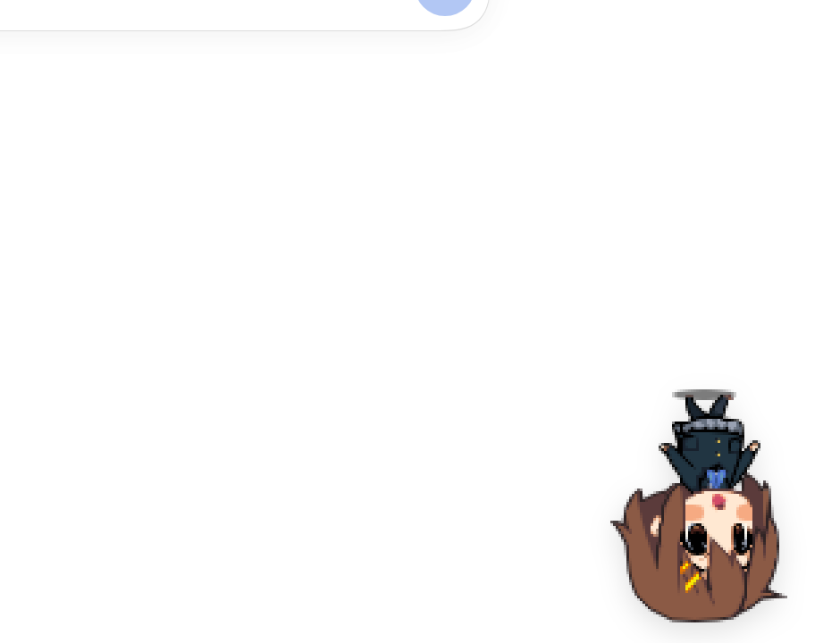
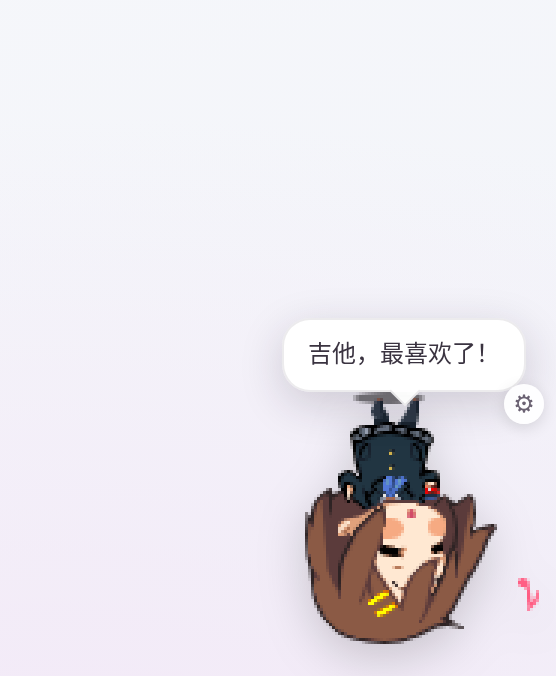

# dsh-k-on-pet

把《K-ON! 轻音少女》的五位角色挂进 **DeepSeek Harness** 的 Web 界面右下角。

这是一个 **DSH 客户端插件**：不改 DSH 源码，不另起窗口，安装后直接悬浮在 Web GUI 上。点击说话、拖动乱跑、双击比心、右键换人；闲置会打瞌睡，忙久了会提醒你喝水休息。

> 非官方同人移植，与原作者、京都动画、芳文社均无关联。资产版权说明见 [THIRD_PARTY_NOTICES.md](THIRD_PARTY_NOTICES.md)。





## 角色与内容

| 角色 | id | 语音 |
| --- | --- | --- |
| 平泽唯 | `yui` | 28 条 |
| 秋山澪 | `mio` | 27 条 |
| 田井中律 | `ritsu` | 30 条 |
| 琴吹䌷 | `tsumugi` | 27 条 |
| 中野梓 | `azusa` | 25 条 |

共 **137 条原版语音**，每张 96×96 精灵图集，包含 6 组动作：

- `idle` 主待机、`idleAlt` 待机变体、`extra` 额外待机
- `react` 被点击、`sleep` 打瞌睡、`held` 被拎起来

## 功能

- **点击**：切换 `react` 动作并随机播一条语音，气泡显示台词。
- **双击**：比心 + 随机台词。
- **拖动 / 甩出**：抓起时播 `held`，松手按速度做抛物线，落地后恢复待机；拖出屏幕会被夹回可视区。
- **闲置**：约 4 分钟无操作进入 `sleep`，再久一点冒 `Zzz` 气泡；任意交互唤醒。
- **随机闲聊**：每 2.5–5 分钟说一句。
- **关怀提醒**：每 50 分钟提醒喝水 / 起身 / 看远处。
- **右键菜单**：换角色、缩放（1.0–2.4）、静音、重置位置。菜单是页面内浮层，不依赖浏览器弹窗。
- **记忆**：角色、缩放、静音、位置存在浏览器 `localStorage`，刷新后恢复。
- **不挡操作**：只有宠物本体接收指针事件，其余区域点击穿透。
- **无网络、无模型调用**：不请求外部接口，不上传任何数据。

## 安装

要求：DSH **Web** profile（桌面端或 `dsh web`），DSH `0.2.x`。当前在 `0.2.1-rc.2` 上实测通过。

### 方式一：插件面板（推荐）

在 DSH 的 **插件 / 插件市场** 里搜索 `dsh-k-on-pet`，安装并启用。面板会同时处理依赖和 bundle 注册。

### 方式二：命令行

```bash
dsh plugin --profile web add dsh-k-on-pet
```

CLI 只把包装进 profile 的 `node_modules`；还需要让 profile 加载它。打开
`$DSH_HOME/profiles/web/package.json`（默认 `~/.dsh/profiles/web/package.json`），把
`"dsh-k-on-pet"` 加进 `dsh.profile.bundles` 数组：

```json
{
  "dsh": {
    "profile": {
      "bundles": ["@deepseek-ai/dsh-base", "@deepseek-ai/dsh-web-app", "dsh-k-on-pet"]
    }
  }
}
```

然后重启 `dsh web` / 桌面端。

### 从 GitHub 安装

仓库发布后：

```bash
dsh plugin --profile web add github:<owner>/dsh-k-on-pet
```

同样把 `dsh-k-on-pet` 加入 `dsh.profile.bundles` 后重启。仓库内已包含构建好的 `lib/` 与 `assets/`，安装时不需要编译。

### 卸载

从 `dsh.profile.bundles` 移除 `dsh-k-on-pet`，然后：

```bash
dsh plugin --profile web remove dsh-k-on-pet
```

### 验证是否加载

登录 DSH Web 后访问：

```bash
curl -s http://127.0.0.1:3080/dsh-k-on-pet/characters/yui/meta.json | head
```

能返回 JSON 说明宿主半已挂载；页面右下角出现唯，说明客户端半已渲染。

## 使用

| 操作 | 效果 |
| --- | --- |
| 左键单击 | 动作 + 语音 + 气泡 |
| 左键双击 | 比心台词 |
| 按住拖动 | 拎起；松手按速度甩出 |
| 右键 / 悬停右上角齿轮 | 设置菜单 |
| 菜单「重置位置」 | 回到右下角 |
| 菜单「静音」 | 关闭语音（动作和气泡保留） |

所有设置只保存在当前浏览器。换浏览器或清空站点数据会恢复默认（唯、1.5×、右下角）。

## 隐私与权限

- 宿主半只注册一个**只读**静态路由：`/dsh-k-on-pet/characters/*`，用于把图集、`meta.json` 和 MP3 发给同源页面。
- 不做遥测、不访问网络、不读写工作区文件、不调用模型。
- 客户端只用 `localStorage` 保存偏好；卸载插件后可自行清除。
- 该资源路由不校验登录态。若你把 DSH Web 暴露到 localhost 之外，这些同人素材也会可被访问；请自行评估。

## 兼容性

| 项 | 说明 |
| --- | --- |
| DSH | `0.2.0-rc.1` / `0.2.0-rc.2` / `0.2.1-rc.2` 标记兼容；`0.2.1-rc.2` 实测 |
| profile | `web`（桌面端 / 浏览器） |
| 平台 | 依赖 Canvas 2D、WebAudio、Pointer Events、`localStorage` |
| 不适用 | TUI / headless profile（没有 `shell.overlay` 与浏览器 API） |

如果 DSH 升级后出现空白，先看浏览器控制台是否有 `shell.overlay` 槽位或静态路由错误；这是 DSH 内部 API 变动时最可能的两处。

## 目录结构

```text
dsh-k-on-pet/
├── package.json          # DSH bundle patch + 客户端注入声明
├── cordis.patch.yml      # 把一个客户端插件挂进 web profile
├── lib/
│   ├── index.js          # 宿主半：只读静态资源路由
│   ├── client.js         # 浏览器半：React 浮层 + Canvas + WebAudio + 状态机
│   └── types/            # 类型声明
├── assets/characters/    # 5 个角色：sheet.png / meta.json / voices/*.mp3
├── docs/                 # README 截图
├── scripts/
│   ├── check.mjs         # 静态自检（包结构、资产、meta 一致性）
│   ├── build-meta.py     # 从 sheet.png 重建 bbox 与动作分组
│   ├── extract-el.py     # 从原版 .el 解码图集（需要原程序资产）
│   └── smoke.mjs         # 无头 Chrome 冒烟测试
└── test/harness.html     # 脱离 DSH 的最小渲染夹具
```

## 从源码开发

仓库里 `lib/client.js` 是可直接运行的普通 JS，不需要打包。

```bash
# 1. 静态检查：包结构、路由、资产、每张图集的帧数与动作
node scripts/check.mjs

# 2. 浏览器冒烟测试（需要 Chrome / Chromium）
node scripts/smoke.mjs
# 或指定浏览器路径
CHROME=/usr/bin/chromium node scripts/smoke.mjs

# 3. 修改图集边缘后重建 meta.json
python3 scripts/build-meta.py
```

`smoke.mjs` 会起一个本地静态服务器，加载 `test/harness.html`，用 CDP 检查：浮层挂载、canvas 有像素、点击出气泡、拖动改变位置、右键菜单出现、菜单切换角色、静音生效、刷新后设置保留。

### 重新生成资产

需要原版程序解包后的 `Mascot*_d` 目录（不在本仓库内）：

```bash
python3 scripts/extract-el.py /path/to/kon <repo>/assets/characters
python3 scripts/build-meta.py
```

`extract-el.py` 记录了对 ELSC 容器、调色板、RLE 和 delta 滤波的完整解码逻辑，可作为格式参考。

## 实现要点

- 通过 `ctx.slots.inject("@deepseek-ai/dsh-client-ui-layout")` 等待 `shell.overlay` 槽位，再 `ctx.slots.register({ name: "shell.overlay" }, KOnPet)` 挂载。浮层是 `position:fixed; inset:0; pointer-events:none`，宠物本体单独开启 `pointer-events:auto`。
- 用 `ctx.effect()` 注册宿主路由，响应体直接从安装目录读文件，带正确的 `Content-Type` 与 `Cache-Control`。
- 精灵图按 96×96 网格切分，`meta.json` 给出每帧 bbox；绘制时只画 bbox 区域，避免透明边影响对位。
- 语音用 `HTMLAudioElement` 播放，点击后预热；静音直接跳过播放，不创建音频对象。
- 状态机只有 `idle / react / sleep / held / drag / throw` 几个状态；定时器在卸载时清理，避免多实例叠加。

## 资产与版权

**代码**以 MIT 发布。

**图像与语音**来自原版 Windows 桌宠 `k-on-pet`（`MascotTable.exe` 与五个 `Mascot*.exe` 的资源包），版权归原作者及《K-ON!》相关权利方所有。原分发中没有找到明确的再分发许可；本仓库将其作为**同人 / 个人使用**的移植示例一并提供，**不随 MIT 授权**。如果你要商用或再分发，请自行取得授权。

若权利方要求，维护者会删除相应资产或整包。详见 [THIRD_PARTY_NOTICES.md](THIRD_PARTY_NOTICES.md)。

## License

- 代码：MIT，见 [LICENSE](LICENSE)。
- 角色图像、语音、名称：不属于 MIT，见 [THIRD_PARTY_NOTICES.md](THIRD_PARTY_NOTICES.md)。
